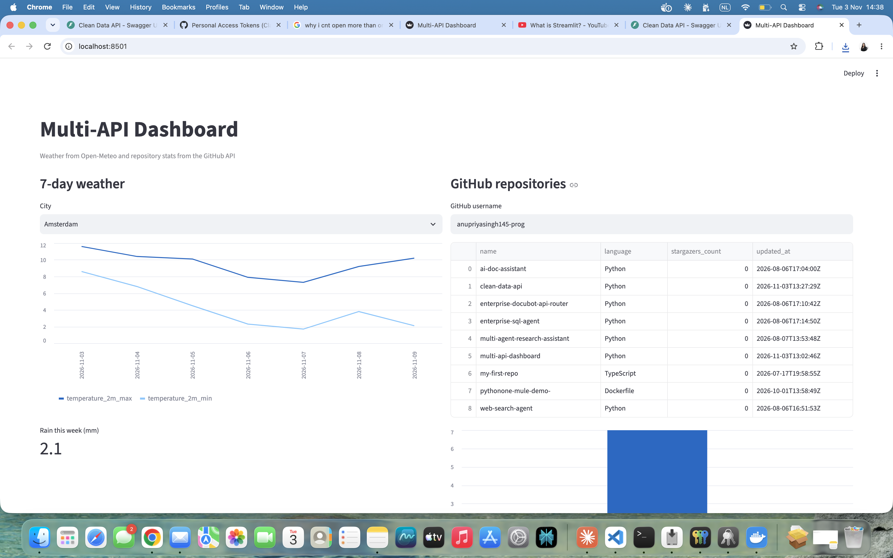

# Multi-API Dashboard

## Problem
Weather data and GitHub activity live in separate systems, so getting a combined view means switching between tools.

## Approach
A Streamlit dashboard that pulls from two public APIs (Open-Meteo and GitHub) and shows charts and tables in one page.
   

## Run it
```
python3 -m venv venv
source venv/bin/activate
pip install -r requirements.txt
streamlit run app.py
```

## Tradeoffs
- Responses are cached for 10 minutes to avoid rate limits
- API failures show a friendly error instead of crashing the page
- The optional `GITHUB_TOKEN` is read from an environment variable and never stored in code

## Next steps
Dockerize, add tests, deploy to the cloud